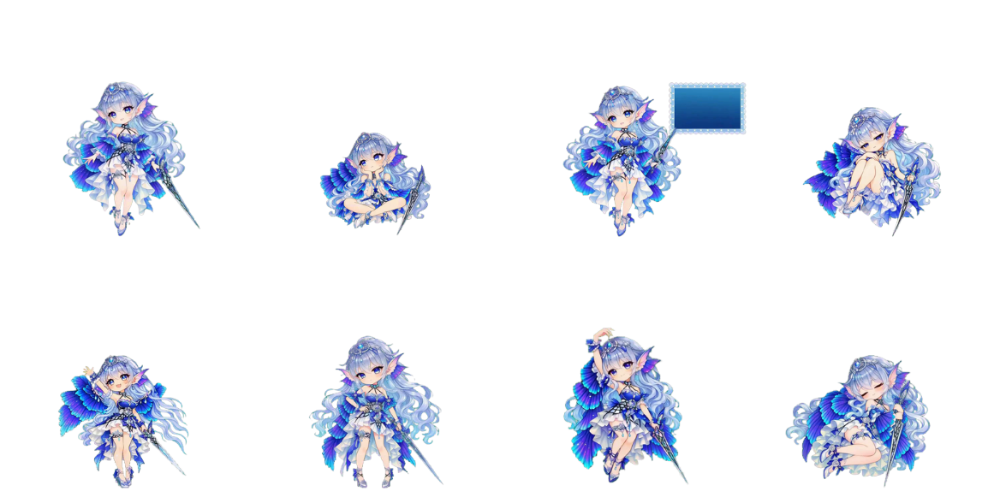
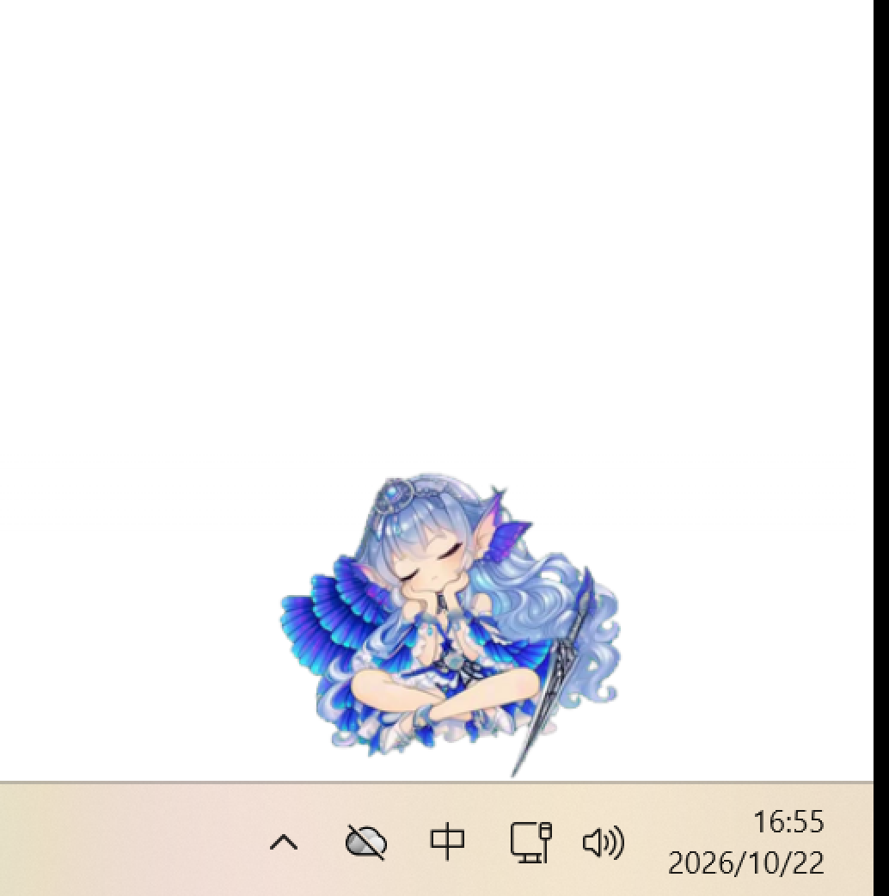
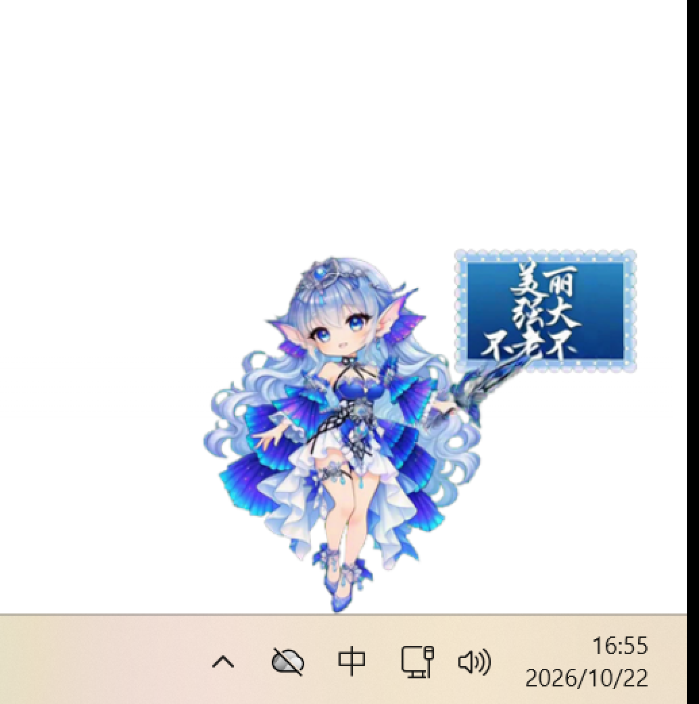
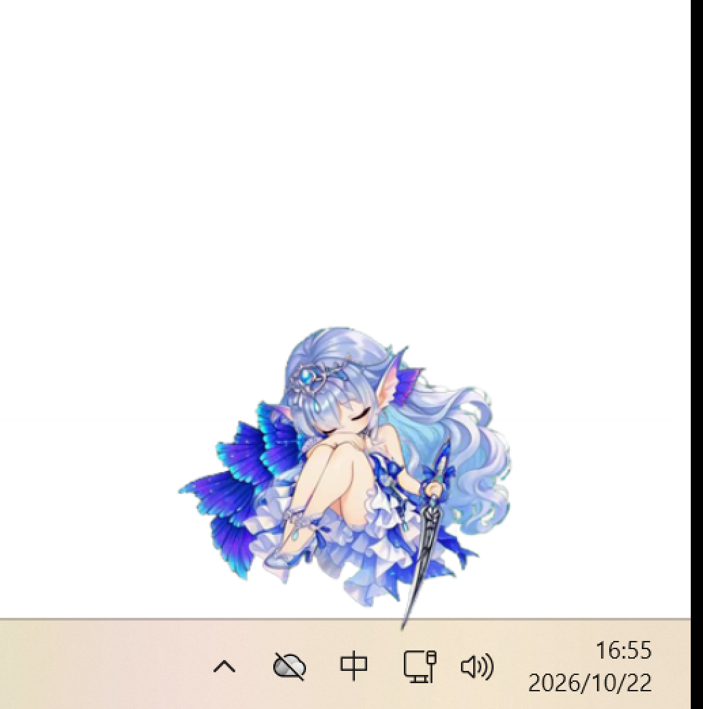
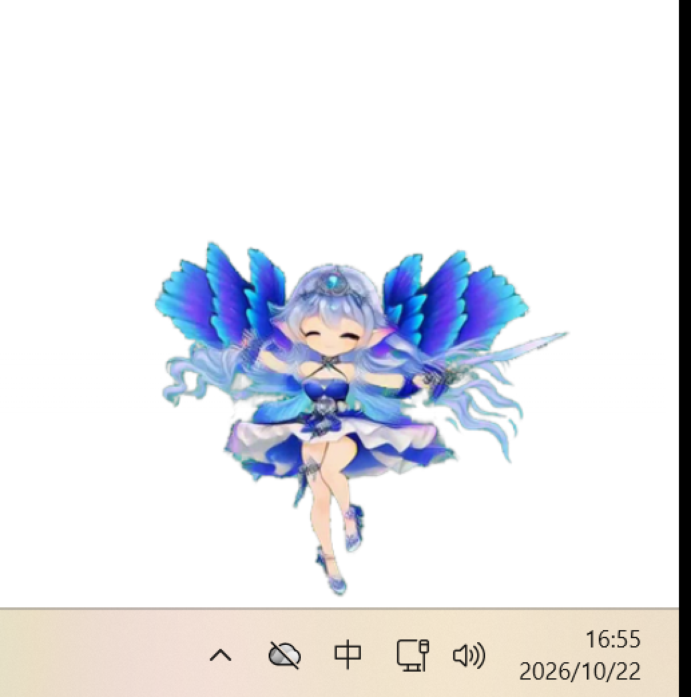
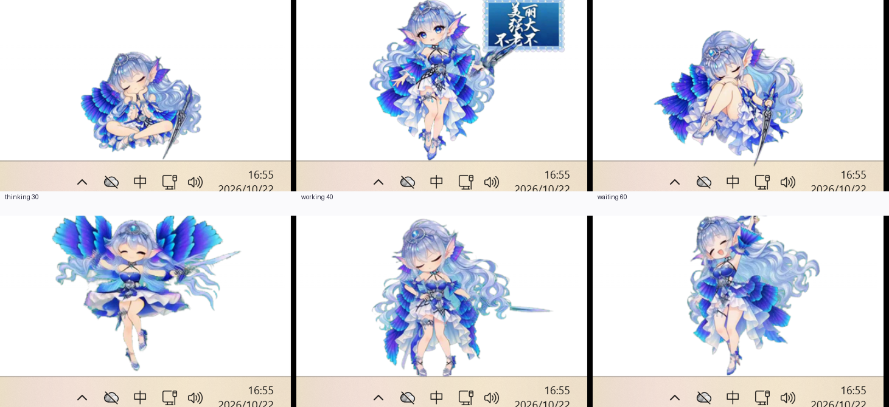

# Tearlaments-dsh-pet

> 人鱼少女桌宠 · **JavaFX** 桌面宠物 + **DSH 插件**（实时反映 DSH agent 的工作状态）

一条八态透明背景素材，从「绿幕视频」到「桌面上的桌宠」，再到「跟着 DSH 干活状态切换表情」的完整链路实现。



- **桌宠本体**：JavaFX + 构建期 PNG 图集（`ImageView.setViewport()` 逐帧播放），透明背景、可拖拽、贴屏幕底、点击穿透。
- **DSH 插件**（`dsh-pet-status`）：在 DSH **宿主进程内**监听 `session/event`，聚合成「工作状态档位」，按 `dsh-pet` 的契约对外提供本地 HTTP 接口，桌宠直接接入；并兼当桌宠的**进程宿主**（装上即拉起、卸载即收掉、崩了重拉）。
- **右键菜单**：状态点播 / 体型 / 点击穿透 / 锁定 / 退出（桌宠没有窗口边框也没有任务栏按钮，右键是唯一入口）。

---

## 效果

| 状态 | 触发（DSH 档位） | 画面 |
|---|---|---|
| 思考 | `thinking` |  |
| 干活 | `working` |  |
| 等批准 | `waiting` |  |
| 完成 | `success` |  |

DSH 六档位对照：



---

## 快速开始

### 依赖

| 组件 | 版本 | 用途 |
| --- | --- | --- |
| JDK | 21 | 编译运行桌宠 |
| Maven | 3.9+ | 构建（`javafx-maven-plugin` / `exec-maven-plugin` / `shade`） |
| Python | 3.10+ | **仅**重建图集时需要（numpy / Pillow / imageio-ffmpeg / scipy） |
| DSH NEXT | ≥ 0.2.1-rc.2 | 装插件、接入真实工作状态 |

### 1) 跑桌宠

```bash
cd desktop-pet
mvn -q compile exec:java -Dexec.mainClass=app.pet.PetApp
```

常用参数：

| 参数 | 说明 |
| --- | --- |
| `--height=<px>` | 角色在屏幕上的高度（逻辑像素），默认按屏高自适应 |
| `--scale=<倍率>` | 直接指定缩放倍率 |
| `--dsh` | 接入 DSH 宿主（自动发现端口：独立模式运行状态文件 → 3080~3104 扫描） |
| `--dsh-port=<端口>` | 指定宿主端口 |
| `--dsh-pet=<id>` | 宠物 id，默认 `main` |
| `--shot=<目录>` | 自检：逐态快照 + 几何断言（回归守卫） |
| `--driftest` | 拖拽跟随漂移自测 |
| `--demo` | 事件模拟器（没有 DSH 事件源时驱动状态机） |
| `--lazy` | 不预热全部图集（省约 200MB 内存） |
| `--through` | 启动即点击穿透 |

### 2) 装 DSH 插件（可选，装了才能跟着 DSH 状态动）

**应用内安装**：DSH 侧边栏「插件」页 →「添加插件」→ 在「包名或地址」里填本仓库插件目录的**绝对路径**：

```
<本仓库>/desktop-pet/tools/dsh-plugin
```

装完**立即生效**，不需要重启 DSH。

命令行等价写法（与 UI 同一套逻辑）：

```powershell
$env:ELECTRON_RUN_AS_NODE='1'; $env:DSH_HOME="$env:USERPROFILE\.dsh"
& "$env:LOCALAPPDATA\Programs\DSH NEXT\DSH NEXT.exe" --expose-internals `
  "$env:LOCALAPPDATA\Programs\DSH NEXT\resources\app.asar\lib\plugin-cli.js" `
  desktop add <本仓库>/desktop-pet/tools/dsh-plugin
```

或者直接双击 `desktop-pet/tools/dsh-plugin/install.bat`。

> 走本地目录时 pnpm 会把它记成 `link:` 依赖（Windows 上是 Junction），**改插件源码即时生效**。

插件细节（接口、档位表、卸载、自测）见 [`desktop-pet/tools/dsh-plugin/README.md`](desktop-pet/tools/dsh-plugin/README.md)。

### 3) 让插件托管桌宠（自动拉起 / 自动收掉）

插件同时兼任桌宠的**进程宿主**：

- **装上插件** → 桌宠自动拉起并接上 3080；
- **卸载插件** → 桌宠自动收掉，不留孤儿进程；
- **桌宠崩了** → 按退避自动重拉。

做法是复制一份启动配置：把 `desktop-pet/tools/dsh-plugin/pet-launch.example.json` 复制成
`pet-launch.json`（**不要提交**，已在 `.gitignore` 里），按本机实际路径改：

```json
{
  "command": [
    "C:/path/to/jdk-21/bin/java.exe",
    "-Dstdout.encoding=UTF-8",
    "--module-path",
    "C:/path/to/javafx-base-21.0.4-win.jar;C:/path/to/javafx-graphics-21.0.4-win.jar;C:/path/to/javafx-controls-21.0.4-win.jar",
    "--add-modules",
    "javafx.controls",
    "-cp",
    "C:/path/to/desktop-pet/target/classes;C:/path/to/gson-2.11.0.jar;C:/path/to/jna-5.14.0.jar;C:/path/to/jna-platform-5.14.0.jar",
    "app.pet.PetApp",
    "--dsh"
  ],
  "cwd": "C:/path/to/desktop-pet",
  "autoRestart": true,
  "restartDelayMs": 3000
}
```

`command` 是**数组**（每个元素一个参数），子进程直接按数组 spawn，不走 shell。

不想托管就把环境变量 `DSH_PET_STATUS_DISABLE_SUPERVISOR=1` 设上，插件只保留「报档位」。

三种运行模式（`/debug` 里能实时看到）：

| 模式 | 触发条件 | 对桌宠生死的态度 |
| --- | --- | --- |
| `adopted` | 锁文件里的 pid 还活着（典型：插件热重载后旧进程遗留） | 接管，不重复拉 |
| `external` | 宽限期 5s 内发现有活连接 | 不碰，只用看门狗盯着 |
| `spawned` | 宽限期 5s 内没有任何活连接 | 自己拉起，并负责收尾 |

诊断：

```bash
curl http://127.0.0.1:3080/dsh-pet-7340/debug
```

**退出语义**：桌宠右键菜单的「退出」走 `Platform.exit()`，**退出码 0** —— 托管器据此判为
「用户主动退出」，**不会**再把它拉起来；只有非 0 退出码 / 被信号杀死才算「崩了」，才走退避重拉。

想手动停 / 起（不卸载插件）：

```bash
curl -X POST http://127.0.0.1:3080/dsh-pet-7340/pet/stop
curl -X POST http://127.0.0.1:3080/dsh-pet-7340/pet/start
```

### 4) 接入

```bash
java ... app.pet.PetApp --dsh
```

桌宠会自动发现插件的端口（默认 **3080**），长轮询取档位并切态。

---

## 交互

桌宠没有窗口边框、也不进任务栏（`WS_EX_TOOLWINDOW`），所以**右键菜单是唯一入口**：

| 组 | 菜单项 |
| --- | --- |
| 状态点播 | 八态各一项（`待机 (idle)` … `休眠 (sleeping)`） |
| 体型 | 紧凑 / 标准 / 加大（基准角色高度在启动时定死） |
| 开关 | 切换点击穿透 / 锁定（冻结自动状态切换） |
| 结束 | 退出（退出码 0 → 插件不再自动拉起） |

**任务栏图标**：任务栏上桌宠那一格认的是 JavaFX 的 toolkit 窗口
（`GlassToolkitWindowClass`），默认是那个灰蓝色机器人图标。改法是给舞台设图标：

```java
stage.getIcons().add(new Image("/pet/taskbar-icon.png"));
```

图标文件**不在仓库里**（默认那张是第三方卡面素材，不适合再分发）——
自己放一张 256×256 的 PNG 到 `desktop-pet/src/main/resources/pet/taskbar-icon.png` 即可；
没有它就静默沿用默认图标，桌宠照常工作。

---

## 目录结构

```
.
├─ desktop-pet/                    # JavaFX 桌宠
│  ├─ pom.xml
│  ├─ src/main/java/app/pet/      # 运行时（8 个类）
│  │  ├─ PetApp.java              #   窗口、缩放、拖拽、命令行参数
│  │  ├─ AtlasPlayer.java         #   图集逐帧播放 + 像素级命中判定
│  │  ├─ StateMachine.java        #   八态优先级判定
│  │  ├─ PetManifest.java         #   manifest.json 解析
│  │  ├─ DshClient.java           #   DSH 契约客户端（长轮询）
│  │  ├─ DshBridge.java           #   档位桥接、端口发现
│  │  └─ Win32.java               #   点击穿透 / 置顶
│  ├─ src/main/resources/pet/     # 构建期产物：8 个图集 + manifest
│  └─ tools/
│     ├─ start_pet_with_dsh.bat    # 一键启动（便携 JDK 版）
│     └─ dsh-plugin/              # DSH 插件（可独立安装）
│        ├─ index.js              #   档位聚合 + HTTP 服务 + 托管接线
│        ├─ pet-supervisor.js     #   进程托管（拉起 / 接管 / 收尾）
│        └─ pet-launch.example.json
├─ pipeline/                       # 构建管线（从源视频重建图集）
│  ├─ states.json                 # 八态优先级与转场表的事实来源
│  ├─ build_atlas.py              # 归一化 → 图集打包 → manifest
│  ├─ verify_atlas.py             # 像素级验收
│  └─ dev/                        # 开发期诊断脚本
├─ scripts/                       # 端到端验收脚本（mock 宿主 / sidecar）
├─ docs/
│  ├─ 设计说明.md                  # 完整设计文档（八章）
│  ├─ 八态动作设计.md
│  └─ images/
└─ LICENSE
```

---

## 构建管线（图集是怎么来的）

JavaFX 的媒体管线（`MediaPlayer` / `MediaView`）**没有 alpha 通路**，所以透明背景视频不能直接播。
本项目的做法是：**构建期把视频转成带 alpha 的 PNG 图集**，运行期用 `ImageView.setViewport()` 逐帧取。

```
八个透明背景版 webm
   │
   ├─ pipeline/green_to_alpha.py     绿幕 → 透明（VP8 alpha，边缘去绿）
   ├─ pipeline/normalize_frame.py    脸部测量与归一化
   ├─ pipeline/build_atlas.py        闭式迭代 → 公共画布 → 图集 + manifest.json
   └─ pipeline/verify_atlas.py       像素级验收（脸宽一致 / 脚底线对齐 / 无裁切 / 循环闭合）
```

**归一化三锚**（这是整套东西的核心）：

| 锚 | 取值 | 为什么 |
| --- | --- | --- |
| 尺度 | 脸宽 41px | 盘腿 / 躺下 / 悬空时「站立高度」根本不成立 |
| 水平 | 脸心 x = 191.21 | 取非透明像素 x 的**中位数**，防手/道具把包围盒中心拉偏 |
| 垂直 | 脚底线 y = 370.78 | 对齐脚底 → 坐就是坐、躺就是躺；`dragging` 例外（运行时由鼠标接管） |

八态验收结果（目标脸宽 41px，公共脚底线 370.78）：

| 状态 | 帧数 | 输出脸宽 | 偏差 | 脚底线 y | 触边帧 | 判定 |
|---|---|---|---|---|---|---|
| idle | 62 | 40.5 | −1.2% | 370.0 | 0 | PASS |
| thinking | 62 | 43.0 | +4.9% | 369.0 | 0 | PASS |
| calling_tool | 62 | 41.5 | +1.2% | 371.0 | 0 | PASS |
| waiting | 78 | 42.0 | +2.4% | 369.0 | 0 | PASS |
| complete | 62 | 43.0 | +4.9% | 370.0 | 0 | PASS |
| error | 62 | 41.0 | 0.0% | 371.0 | 0 | PASS |
| dragging | 62 | 42.0 | +2.4% | 372.0 | 0 | PASS |
| sleeping | 96 | 41.5 | +1.2% | 369.0 | 0 | PASS |

自己跑一遍（仓库里已带图集与管线，直接可验）：

```bash
python pipeline/verify_atlas.py
```

重建图集需要源素材（八个透明背景版 webm，**未入库**），放到 `assets/alpha-webm/` 或用环境变量指定：

```bash
PET_SRC_ALPHA=/path/to/alpha-webm python pipeline/build_atlas.py
```

---

## DSH 接入

### 档位与优先级

档位优先级用 **DSH 宿主那一套**（`waiting > error > working > thinking > result > success`），
这张表是**宿主侧的合并表**：跨会话取优先级最高的那条，同级取最近更新的。

> 客户端**不再自己比一次 rank**——同一会话的正常递进是档位序下降的
> （等待批准 `waiting`(60) → 干活 `working`(40) → 工具返回 `result`(25)），
> 再比一次会永远卡在「等待」上。

### 档位 → 八态

| DSH 档位 | 桌宠状态 | 播放语义 |
| --- | --- | --- |
| `thinking` | thinking | 循环播 |
| `working` | calling_tool | 循环播 |
| `waiting` | waiting | 循环播 |
| `result` | thinking | 循环播（整理 ≈ 托腮思考） |
| `success` | complete | **播一遍**回 idle |
| `error` | error | **播一遍**回 idle |

三条护栏：用户交互优先（拖拽期间丢弃档位、松手恢复）、占用锁冻结（动画停在最后一帧，`expiresAt` 自行解除）、终态一次性。

---

## 踩坑记录（最硬的几条）

1. **JavaFX 媒体管线没有 alpha 通路** —— `MediaPlayer`/`MediaView` 播不了透明背景视频，必须走构建期 PNG 图集。
2. **`Node.setScaleX/Y` 绕的是节点包围盒中心，不是原点** —— 会把内容挤出窗口。要绕原点缩放必须用显式 `new Scale(s, s, 0, 0)`。
3. **拖拽跟随要用绝对偏移，不能增量累加** —— `setX(getX()+delta)` 会把任何状态切换位移累积成漂移。
4. **姿态切换的窗口补偿要用角色锚点（脸心），不能���内容包围盒角点** —— 角点在 idle 是发梢、在 dragging 是举起的手，能差 50+px，一按就跳。
5. **DSH 的档位优先级在宿主侧合并** —— 客户端只跟随，别二次仲裁（见上）。
6. **DSH 桌面版 webServer 有「浏览器访问」闸门** —— 关闭时对**任何**路径都回 403，跨进程客户端读不到，所以插件自起 127.0.0.1 端口。
7. **运行期挂载的插件监听 `session/event` 要加 `{ global: true }`** —— Cordis 按隔离作用域过滤监听器，否则会「插件在跑但收不到事件」。
8. **判「桌宠还活着吗」要用活连接，不能用时间戳** —— 时间戳分不清「18 秒前还活着」和「18 秒前就已经死了」，宽限期一过就会误拉一只。
9. **插件热重载会让模块级变量归零** —— 「最近见过桌宠」这种记忆放内存里，重载后就会双开；归属要落盘（`~/.dsh-pet/pet.lock.json`），且换手时改写 owner，旧实例才不会误杀桌宠。
10. **Windows 上 PowerShell `Set-Content -Encoding UTF8` 会写 BOM** —— 插件读 JSON 直接 `JSON.parse` 会抛，配置解析失败必须打日志，不能静默。
11. **`MouseEvent.isStillSincePress()` 不能当「按键还按着吗」用** —— 它对 `MOUSE_DRAGGED` 一律返回 false，拖拽会刚起来就被自己的兜底掐掉（~25ms）。要判就判 `GetAsyncKeyState(VK_LBUTTON)`。
12. **任务栏上桌宠那一格不是舞台窗口** —— 舞台带 `WS_EX_TOOLWINDOW`，占着格子的其实是 JavaFX 的 toolkit 窗口；给舞台设 `getIcons()` 就能换（Windows 任务栏按进程分组取组内图标），不必自己发 `WM_SETICON`。
13. **脚本化拖拽自测没有真实按键** —— `--driftest` / `--dshdrag` 不发真实鼠标事件，按键态判据会把它们误掐（连带让 e2e 的「拖拽期间档位更新被丢弃」断言失败）；给这类拖拽留一个 `syntheticDrag` 旁路。

完整记录见 [`docs/设计说明.md`](docs/设计说明.md)。

---

## 参考与致谢

- 桌宠插件范式、状态优先级模型、动画链语义参考 **[PC2005-cloud/dsh-pet](https://github.com/PC2005-cloud/dsh-pet)**（MIT）。
- DSH 插件形态（bundle patch / `session/event` / `dsh.profile.bundles`）参考
  **[deepseek-ai/deepseek-harness](https://github.com/deepseek-ai/deepseek-harness)** 与 DSH 商店插件规范。

---

## License

MIT，见 [LICENSE](LICENSE)。

素材（源视频与图集）为 AI 生成；仓库内不含源视频，仅含构建产物与管线。

---

## English

**Tearlaments-dsh-pet** — a mermaid desktop pet built with JavaFX, plus a DSH plugin that feeds it
the agent's live work status.

- **Runtime**: JavaFX + build-time PNG atlases (`ImageView.setViewport()`), because JavaFX's media
  pipeline has no alpha channel. Transparent background, draggable, pinned to the screen bottom,
  click-through.
- **DSH plugin** (`dsh-pet-status`): listens to `session/event` *inside the DSH host process*,
  aggregates the session events into work-status tiers, and serves them over the local
  `dsh-pet` contract. Install it straight from DSH: *Plugins → Add plugin → local directory path*.
  No DSH restart needed.
- **Process supervision**: the plugin also owns the pet process — the pet is launched when the
  plugin is installed, shut down when the plugin is removed, and restarted if it crashes.
  Configure it with `desktop-pet/tools/dsh-plugin/pet-launch.json` (see `pet-launch.example.json`).
  Liveness is judged by *live connections* (pending `/state` long polls), never by timestamps.

```
desktop-pet/   JavaFX runtime + DSH plugin
pipeline/      build pipeline (alpha extraction → normalization → atlas → pixel-level verification)
scripts/       end-to-end test harness
docs/          design notes (Chinese)
```

Tier priority follows DSH's own host-side table
(`waiting > error > working > thinking > result > success`); the client follows the merged result
instead of re-ranking it. Build with `mvn compile exec:java`, verify the shipped atlases with
`python pipeline/verify_atlas.py`.

MIT licensed.
